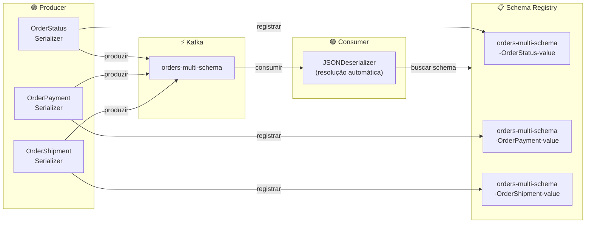
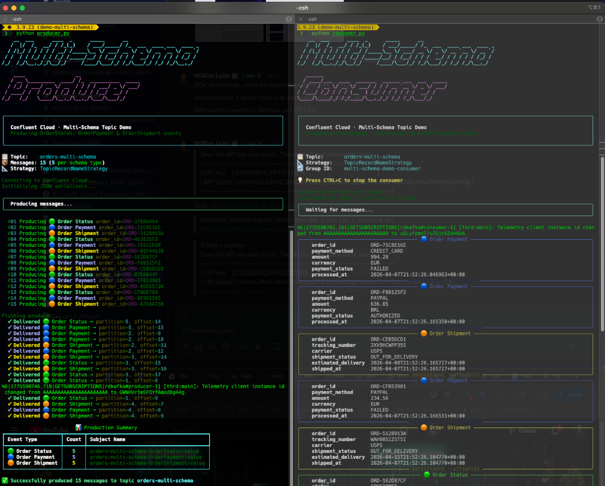

# 📦 Multi-Schema Topic Demo — Confluent Cloud


[](README-BR.md)

Guia passo a passo para produzir e consumir **múltiplos tipos de eventos** em um **único tópico Kafka** no Confluent Cloud, utilizando **JSON Schema** com a estratégia **TopicRecordNameStrategy**.

> 🇺🇸 **English:** This guide is also available in English! See the [README.md](README.md).

---

## 📖 Índice

1. [Visão Geral e Arquitetura](#-visão-geral-e-arquitetura)
2. [Pré-requisitos](#-pré-requisitos)
3. [Configuração do Confluent Cloud](#-configuração-do-confluent-cloud)
4. [Criação dos Schemas](#-criação-dos-schemas)
5. [Criação do Tópico](#-criação-do-tópico)
6. [Associação Schema-Tópico](#-associação-schema-tópico)
7. [Configuração do Ambiente Python](#-configuração-do-ambiente-python)
8. [Executando o Producer](#-executando-o-producer)
9. [Executando o Consumer](#-executando-o-consumer)
10. [Limpeza](#-limpeza)

---

## 🏗️ Visão Geral e Arquitetura

Em sistemas orientados a eventos do mundo real, é comum publicar **múltiplos tipos de eventos em um único tópico**. Por exemplo, um tópico `orders` pode conter:

| Tipo de Evento | Finalidade |
|---|---|
| 🟢 **OrderStatus** | Acompanha o ciclo de vida do pedido (PENDING → CONFIRMED → COMPLETED) |
| 🔵 **OrderPayment** | Registra transações e status de pagamento |
| 🟠 **OrderShipment** | Acompanha o progresso de envio e entrega |

Este demo mostra como fazer isso utilizando o **Schema Registry do Confluent Cloud** com a estratégia **TopicRecordNameStrategy**, que registra cada tipo de evento como um subject separado para evolução independente do schema.

### Diagrama de Arquitetura



> 📐 **Nomenclatura dos Subjects**: Com o `TopicRecordNameStrategy`, cada schema é registrado sob seu próprio subject:
> `<topic>-<record_name>-value` (ex: `orders-multi-schema-OrderStatus-value`)

Para uma referência detalhada da arquitetura, veja [`assets/architecture.md`](assets/architecture.md).

---

## ✅ Pré-requisitos

### Obrigatório

- **Conta no Confluent Cloud** — [Crie gratuitamente](https://www.confluent.io/confluent-cloud/tryfree/)
- **Python 3.8+**
- **uv** — Gerenciador rápido de pacotes Python ([docs](https://docs.astral.sh/uv/))

### Opcional

- **Confluent CLI** — Para configuração via linha de comando (alternativa à UI)

### Instalando o Python

<details>
<summary>🍎 macOS</summary>

```bash
# Usando Homebrew
brew install python3

# Verificar
python3 --version
```
</details>

<details>
<summary>🐧 Linux (Ubuntu/Debian)</summary>

```bash
sudo apt update && sudo apt install python3 python3-venv

# Verificar
python3 --version
```
</details>

<details>
<summary>🪟 Windows</summary>

```powershell
# Baixe em https://www.python.org/downloads/
# Ou use o winget:
winget install Python.Python.3.12

# Verificar
python --version
```
</details>

### Instalando o uv

<details>
<summary>🍎 macOS</summary>

```bash
# Usando Homebrew
brew install uv

# Ou usando o instalador standalone
curl -LsSf https://astral.sh/uv/install.sh | sh
```
</details>

<details>
<summary>🐧 Linux</summary>

```bash
curl -LsSf https://astral.sh/uv/install.sh | sh
```
</details>

<details>
<summary>🪟 Windows</summary>

```powershell
# Usando o instalador standalone
powershell -ExecutionPolicy ByPass -c "irm https://astral.sh/uv/install.ps1 | iex"

# Ou usando winget
winget install --id=astral-sh.uv -e
```
</details>

Verifique a instalação:

```bash
uv --version
```

### Instalando o Confluent CLI

<details>
<summary>🍎 macOS</summary>

```bash
brew install confluentinc/tap/cli
```
</details>

<details>
<summary>🐧 Linux</summary>

```bash
curl -sL --http1.1 https://cnfl.io/cli | sh -s -- latest
export PATH="$HOME/bin:$PATH"
```
</details>

<details>
<summary>🪟 Windows</summary>

```powershell
# Usando Scoop
scoop bucket add confluent https://github.com/confluentinc/scoop-bucket.git
scoop install confluent-cli
```
</details>

Após a instalação, faça login:

```bash
confluent login
```

---

## ☁️ Configuração do Confluent Cloud

Siga estes passos para configurar seu ambiente no Confluent Cloud. Cada passo mostra os caminhos via **UI** e **CLI**.

### Passo 1 — Criar ou Selecionar um Environment

<details>
<summary>🖥️ Via UI</summary>

1. Acesse o [Console do Confluent Cloud](https://confluent.cloud/)
2. Clique em **Environments** na barra lateral esquerda
3. Clique em **+ Add cloud environment**
4. Nomeie (ex: `multi-schema-demo`) e clique em **Create**
</details>

<details>
<summary>💻 Via CLI</summary>

```bash
# Listar environments existentes
confluent environment list

# Criar um novo
confluent environment create multi-schema-demo

# Definir como ativo
confluent environment use <env-id>
```
</details>

---

### Passo 2 — Criar um Kafka Cluster

<details>
<summary>🖥️ Via UI</summary>

1. Dentro do seu environment, clique em **Add cluster**
2. Selecione **Basic** (nível gratuito)
3. Escolha o provedor de nuvem e a região
4. Nomeie (ex: `demo-cluster`) e clique em **Launch cluster**
</details>

<details>
<summary>💻 Via CLI</summary>

```bash
# Criar um cluster Basic
confluent kafka cluster create demo-cluster \
  --cloud aws \
  --region us-east-1 \
  --type basic

# Definir como ativo
confluent kafka cluster use <cluster-id>
```
</details>

---

### Passo 3 — Criar API Keys do Kafka

Essas credenciais permitem que sua aplicação Python se conecte ao cluster Kafka.

<details>
<summary>🖥️ Via UI</summary>

1. Vá para **Cluster Overview** → **API Keys**
2. Clique em **Create key**
3. Escolha **Global access** (para fins de demonstração)
4. Copie a **API Key** e o **API Secret** — você precisará deles para o `.env`
5. Encontre a **URL do Bootstrap server** em **Cluster Overview** → **Cluster Settings**
</details>

<details>
<summary>💻 Via CLI</summary>

```bash
# Criar API key do Kafka
confluent api-key create --resource <cluster-id>

# A saída mostrará:
# API Key:    <KAFKA_API_KEY>
# API Secret: <KAFKA_API_SECRET>

# Obter a URL do bootstrap server
confluent kafka cluster describe <cluster-id> -o json | jq -r '.endpoint'
```
</details>

---

### Passo 4 — Criar API Keys do Schema Registry

Essas credenciais permitem que sua aplicação registre e busque schemas.

<details>
<summary>🖥️ Via UI</summary>

1. No seu environment, clique em **Schema Registry** no painel direito
2. Clique em **API credentials** → **Create key**
3. Copie a **API Key** e o **API Secret**
4. Anote a **URL do Schema Registry** (exibida no topo da página do Schema Registry)
</details>

<details>
<summary>💻 Via CLI</summary>

```bash
# Obter o cluster ID e a endpoint URL do Schema Registry
confluent schema-registry cluster describe

# A saída mostrará (campos relevantes):
# +----------------+----------------------------------------------------+
# | Cluster        | lsrc-xxxxx                                         |
# | Endpoint URL   | https://psrc-xxxxx.us-east-1.aws.confluent.cloud   |
# +----------------+----------------------------------------------------+

# Criar API key do Schema Registry usando o Cluster ID obtido acima
confluent api-key create --resource lsrc-xxxxx

# A saída mostrará:
# API Key:    <SCHEMA_REGISTRY_API_KEY>
# API Secret: <SCHEMA_REGISTRY_API_SECRET>
```
</details>

---

## 📐 Criação dos Schemas

Este demo utiliza três **JSON Schemas** que representam diferentes eventos do ciclo de vida de um pedido:

### Schema OrderStatus

Acompanha o estado do ciclo de vida do pedido.

```json
{
  "$schema": "http://json-schema.org/draft-07/schema#",
  "title": "OrderStatus",
  "type": "object",
  "properties": {
    "order_id": { "type": "string" },
    "status": {
      "type": "string",
      "enum": ["PENDING", "CONFIRMED", "PROCESSING", "COMPLETED", "CANCELLED"]
    },
    "updated_at": { "type": "string", "format": "date-time" },
    "customer_id": { "type": "string" }
  },
  "required": ["order_id", "status", "updated_at", "customer_id"]
}
```

### Schema OrderPayment

Registra transações e status de pagamento.

```json
{
  "$schema": "http://json-schema.org/draft-07/schema#",
  "title": "OrderPayment",
  "type": "object",
  "properties": {
    "order_id": { "type": "string" },
    "payment_method": {
      "type": "string",
      "enum": ["CREDIT_CARD", "DEBIT_CARD", "PIX", "PAYPAL", "BANK_TRANSFER"]
    },
    "amount": { "type": "number" },
    "currency": { "type": "string" },
    "payment_status": {
      "type": "string",
      "enum": ["INITIATED", "AUTHORIZED", "CAPTURED", "REFUNDED", "FAILED"]
    },
    "processed_at": { "type": "string", "format": "date-time" }
  },
  "required": ["order_id", "payment_method", "amount", "currency", "payment_status", "processed_at"]
}
```

### Schema OrderShipment

Acompanha o progresso de envio e entrega.

```json
{
  "$schema": "http://json-schema.org/draft-07/schema#",
  "title": "OrderShipment",
  "type": "object",
  "properties": {
    "order_id": { "type": "string" },
    "tracking_number": { "type": "string" },
    "carrier": {
      "type": "string",
      "enum": ["FEDEX", "UPS", "DHL", "USPS", "CORREIOS"]
    },
    "shipment_status": {
      "type": "string",
      "enum": ["LABEL_CREATED", "PICKED_UP", "IN_TRANSIT", "OUT_FOR_DELIVERY", "DELIVERED"]
    },
    "estimated_delivery": { "type": "string", "format": "date-time" },
    "shipped_at": { "type": "string", "format": "date-time" }
  },
  "required": ["order_id", "tracking_number", "carrier", "shipment_status", "shipped_at"]
}
```

### Registrando Schemas (Opcional — O Producer registra automaticamente)

O producer irá **registrar automaticamente** os schemas na primeira produção de mensagem. No entanto, você pode registrá-los manualmente:

<details>
<summary>🖥️ Via UI</summary>

1. Vá para **Schema Registry** → **Schemas**
2. Clique em **Add schema**
3. Para cada schema:
   - Defina o subject como:
     - `orders-multi-schema-OrderStatus-value`
     - `orders-multi-schema-OrderPayment-value`
     - `orders-multi-schema-OrderShipment-value`
   - Selecione **JSON Schema** como formato
   - Cole o conteúdo do schema
   - Clique em **Create**
</details>

<details>
<summary>💻 Via CLI</summary>

```bash
# Registrar cada schema sob seu subject TopicRecordNameStrategy
confluent schema-registry schema create \
  --subject orders-multi-schema-OrderStatus-value \
  --schema schemas/order_status.json \
  --type JSON

confluent schema-registry schema create \
  --subject orders-multi-schema-OrderPayment-value \
  --schema schemas/order_payment.json \
  --type JSON

confluent schema-registry schema create \
  --subject orders-multi-schema-OrderShipment-value \
  --schema schemas/order_shipment.json \
  --type JSON
```
</details>

---

## 📬 Criação do Tópico

Crie o tópico `orders-multi-schema` que vai transportar os três tipos de eventos.

<details>
<summary>🖥️ Via UI</summary>

1. Vá para **Topics** → **Create topic**
2. Nome: `orders-multi-schema`
3. Partições: `6`
4. Retenção: `7 dias` (168 horas)
5. Clique em **Create with defaults** (ou customize conforme necessário)
</details>

<details>
<summary>💻 Via CLI</summary>

```bash
confluent kafka topic create orders-multi-schema \
  --partitions 6
```
</details>

---

## 🔗 Associação Schema-Tópico

Com o **TopicRecordNameStrategy**, a associação é automática. Quando o producer serializa uma mensagem, ele utiliza esta convenção de nomenclatura para o subject:

```
Subject = <topic>-<record_name>-value
```

| Tipo de Evento | Nome do Subject                           |
| -------------- | ----------------------------------------- |
| OrderStatus    | `orders-multi-schema-OrderStatus-value`   |
| OrderPayment   | `orders-multi-schema-OrderPayment-value`  |
| OrderShipment  | `orders-multi-schema-OrderShipment-value` |

Cada schema evolui independentemente sob seu próprio subject, permitindo que você:
- ✅ Adicione novos campos em `OrderPayment` sem afetar `OrderStatus`
- ✅ Altere enums em `OrderShipment` de forma independente
- ✅ Versione cada tipo de evento separadamente

---

## 🐍 Configuração do Ambiente Python

### 1. Clonar o Repositório

```bash
git clone https://github.com/your-username/Demo-Multi-Schema-Topic.git
cd Demo-Multi-Schema-Topic
```

### 2. Criar um Virtual Environment

<details>
<summary>🍎 macOS / 🐧 Linux</summary>

```bash
uv venv demo-multi-schema
source demo-multi-schema/bin/activate
```
</details>

<details>
<summary>🪟 Windows</summary>

```powershell
uv venv demo-multi-schema
.\demo-multi-schema\Scripts\activate
```
</details>

### 3. Instalar Dependências

```bash
uv pip install -r requirements.txt
```

### 4. Configurar Credenciais

```bash
# Copiar o arquivo de exemplo
cp .env.example .env
```

Edite o `.env` com suas credenciais do Confluent Cloud:

```env
# Confluent Cloud - Kafka Cluster
BOOTSTRAP_SERVERS=pkc-xxxxx.region.provider.confluent.cloud:9092
KAFKA_API_KEY=your-kafka-api-key
KAFKA_API_SECRET=your-kafka-api-secret

# Confluent Cloud - Schema Registry
SCHEMA_REGISTRY_URL=https://psrc-xxxxx.region.provider.confluent.cloud
SCHEMA_REGISTRY_API_KEY=your-sr-api-key
SCHEMA_REGISTRY_API_SECRET=your-sr-api-secret

# Topic
TOPIC_NAME=orders-multi-schema
```

> 💡 **Onde encontrar esses valores:**
> - **Bootstrap server**: Cluster Overview → Cluster Settings
> - **Kafka API key/secret**: Cluster Overview → API Keys
> - **Schema Registry URL**: Environment → Schema Registry
> - **SR API key/secret**: Schema Registry → API Credentials

---

## 🚀 Executando o Producer

Abra um terminal e execute:

```bash
cd src
python producer.py
```

### Saída Esperada

```
    __  ___      ____  _        _____      __
   /  |/  /_  __/ / /_(_)      / ___/_____/ /_  ___  ____ ___  ____ _
  / /|_/ / / / / / __/ /  ____ \__ \/ ___/ __ \/ _ \/ __ `__ \/ __ `/
 / /  / / /_/ / / /_/ /  /___//__/ / /__/ / / /  __/ / / / / / /_/ /
/_/  /_/\__,_/_/\__/_/        /____/\___/_/ /_/\___/_/ /_/ /_/\__,_/

    ____                 __
   / __ \_________  ____/ /_  ________  _____
  / /_/ / ___/ __ \/ __  / / / / ___/ _ \/ ___/
 / ____/ /  / /_/ / /_/ / /_/ / /__/  __/ /
/_/   /_/   \____/\__,_/\__,_/\___/\___/_/

╭─────────────────────────────────────────────────────╮
│  Confluent Cloud · Multi-Schema Topic Demo          │
│  Producing OrderStatus, OrderPayment & OrderShipment│
╰─────────────────────────────────────────────────────╯

📋 Topic:    orders-multi-schema
📦 Messages: 15 (5 por tipo de schema)
📐 Strategy: TopicRecordNameStrategy

  #01 Producing 🟢 Order Status    order_id=ORD-A1B2C3D4
  ✓ Delivered 🟢 Order Status → partition=2, offset=0
  #02 Producing 🔵 Order Payment   order_id=ORD-E5F6G7H8
  ✓ Delivered 🔵 Order Payment → partition=4, offset=0
  #03 Producing 🟠 Order Shipment  order_id=ORD-I9J0K1L2
  ✓ Delivered 🟠 Order Shipment → partition=1, offset=0
  ...

┌──────────────────────────────────────────────────────┐
│                 📊 Production Summary                │
├──────────────┬───────┬──────────────────────────────-┤
│ Event Type   │ Count │ Subject Name                  │
├──────────────┼───────┼───────────────────────────────┤
│ 🟢 Status   │   5   │ orders-multi-schema-Order...   │
│ 🔵 Payment  │   5   │ orders-multi-schema-Order...   │
│ 🟠 Shipment │   5   │ orders-multi-schema-Order...   │
└──────────────┴───────┴───────────────────────────────┘

✅ Successfully produced 15 messages to topic orders-multi-schema
```

---

## 📡 Executando o Consumer

Abra uma **segunda aba/janela do terminal**, ative o virtual environment e execute:

<details>
<summary>🍎 macOS / 🐧 Linux</summary>

```bash
source demo-multi-schema/bin/activate
cd src
python consumer.py
```
</details>

<details>
<summary>🪟 Windows</summary>

```powershell
.\demo-multi-schema\Scripts\activate
cd src
python consumer.py
```
</details>

### Saída Esperada

```
    __  ___      ____  _        _____      __
   /  |/  /_  __/ / /_(_)      / ___/_____/ /_  ___  ____ ___  ____ _
  / /|_/ / / / / / __/ /  ____ \__ \/ ___/ __ \/ _ \/ __ `__ \/ __ `/
 / /  / / /_/ / / /_/ /  /___//__/ / /__/ / / /  __/ / / / / / /_/ /
/_/  /_/\__,_/_/\__/_/        /____/\___/_/ /_/\___/_/ /_/ /_/\__,_/

     ______                                            
    / ____/___  ____  _______  ______ ___  ___  _____  
   / /   / __ \/ __ \/ ___/ / / / __ `__ \/ _ \/ ___/  
  / /___/ /_/ / / / (__  ) /_/ / / / / / /  __/ /      
  \____/\____/_/ /_/____/\__,_/_/ /_/ /_/\___/_/       

╭─────────────────────────────────────────────────────╮
│  Confluent Cloud · Multi-Schema Topic Demo          │
│  Consuming OrderStatus, OrderPayment & OrderShipment│
╰─────────────────────────────────────────────────────╯

💡 Pressione CTRL+C para parar o consumer

╭──── 🟢 Order Status ────────────────────────────────╮
│  order_id      ORD-A1B2C3D4                         │
│  status        CONFIRMED                            │
│  updated_at    2026-04-02T15:30:00Z                 │
│  customer_id   CUST-4521                            │
│                          partition=2 · offset=0     │
╰─────────────────────────────────────────────────────╯
╭──── 🔵 Order Payment ───────────────────────────────╮
│  order_id         ORD-E5F6G7H8                      │
│  payment_method   CREDIT_CARD                       │
│  amount           149.99                            │
│  currency         USD                               │
│  payment_status   CAPTURED                          │
│  processed_at     2026-04-02T15:30:01Z              │
│                          partition=4 · offset=0     │
╰─────────────────────────────────────────────────────╯
╭──── 🟠 Order Shipment ──────────────────────────────╮
│  order_id            ORD-I9J0K1L2                   │
│  tracking_number     X9K2M4P7Q1R3                   │
│  carrier             FEDEX                          │
│  shipment_status     IN_TRANSIT                     │
│  estimated_delivery  2026-04-07T15:30:00Z           │
│  shipped_at          2026-04-02T15:30:02Z           │
│                          partition=1 · offset=0     │
╰─────────────────────────────────────────────────────╯

  Pressione CTRL+C para parar...

┌──────────────────────────────────────────────────────┐
│              📊 Consumption Summary                  │
├──────────────┬───────┤                               │
│ Event Type   │ Count │                               │
├──────────────┼───────┤                               │
│ 🟢 Status   │   5   │                               │
│ 🔵 Payment  │   5   │                               │
│ 🟠 Shipment │   5   │                               │
└──────────────┴───────┘                               │

✅ Consumer encerrado com sucesso. Total de mensagens consumidas: 15
```

---

## 💡 Dica — Terminal Dividido

Para a melhor experiência, divida seu terminal **verticalmente** para executar o producer e o consumer lado a lado. Assim você pode acompanhar os eventos sendo produzidos na esquerda e consumidos na direita em tempo real!



---

## 🧹 Limpeza

Quando terminar o demo, limpe seus recursos no Confluent Cloud:

<details>
<summary>🖥️ Via UI</summary>

1. **Deletar o tópico**: Topics → `orders-multi-schema` → Settings → Delete topic
2. **Deletar os schemas**: Schema Registry → Delete em cada subject
3. **Deletar as API keys**: Cluster → API Keys → Delete
4. **Deletar o cluster** (opcional): Cluster → Settings → Delete cluster
</details>

<details>
<summary>💻 Via CLI</summary>

```bash
# Deletar tópico
confluent kafka topic delete orders-multi-schema

# Deletar schemas
confluent schema-registry schema delete \
  --subject orders-multi-schema-OrderStatus-value --version all
confluent schema-registry schema delete \
  --subject orders-multi-schema-OrderPayment-value --version all
confluent schema-registry schema delete \
  --subject orders-multi-schema-OrderShipment-value --version all

# Hard-delete dos schemas (permanente)
confluent schema-registry schema delete \
  --subject orders-multi-schema-OrderStatus-value --version all --permanent
confluent schema-registry schema delete \
  --subject orders-multi-schema-OrderPayment-value --version all --permanent
confluent schema-registry schema delete \
  --subject orders-multi-schema-OrderShipment-value --version all --permanent

# Deletar API keys (opcional)
confluent api-key delete <kafka-api-key>
confluent api-key delete <sr-api-key>
```
</details>

---

## 📚 Recursos

- [Confluent Blog — Multiple Event Types in the Same Topic](https://www.confluent.io/blog/multiple-event-types-in-the-same-kafka-topic/)
- [Schema Registry Subject Name Strategy](https://docs.confluent.io/platform/current/schema-registry/fundamentals/serdes-develop/index.html#subject-name-strategy)
- [Documentação confluent-kafka-python](https://docs.confluent.io/platform/current/clients/confluent-kafka-python/html/index.html)
- [JSON Schema Serializer/Deserializer](https://docs.confluent.io/platform/current/schema-registry/fundamentals/serdes-develop/serdes-json.html)

---

## 📝 Licença

Este projeto é fornecido como um guia de demonstração. Use-o livremente para aprendizado e experimentação.
