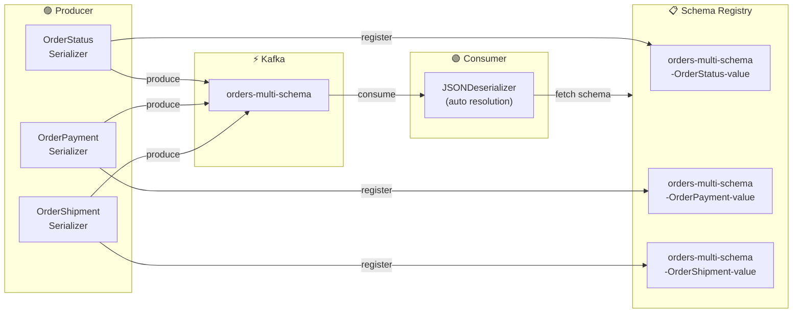

# 📦 Multi-Schema Topic Demo — Confluent Cloud

A step-by-step guide for producing and consuming **multiple event types** on a **single Kafka topic** in Confluent Cloud, using **JSON Schema** with the **TopicRecordNameStrategy**.

---

## 📖 Table of Contents

1. [Overview & Architecture](#-overview--architecture)
2. [Prerequisites](#-prerequisites)
3. [Confluent Cloud Setup](#-confluent-cloud-setup)
4. [Schema Creation](#-schema-creation)
5. [Topic Creation](#-topic-creation)
6. [Schema-Topic Association](#-schema-topic-association)
7. [Python Environment Setup](#-python-environment-setup)
8. [Running the Producer](#-running-the-producer)
9. [Running the Consumer](#-running-the-consumer)
10. [Cleanup](#-cleanup)

---

## 🏗️ Overview & Architecture

In real-world event-driven systems, it's common to publish **multiple event types to a single topic**. For example, an `orders` topic might carry:

| Event Type | Purpose |
|---|---|
| 🟢 **OrderStatus** | Tracks order lifecycle (PENDING → CONFIRMED → COMPLETED) |
| 🔵 **OrderPayment** | Records payment transactions and statuses |
| 🟠 **OrderShipment** | Tracks shipping and delivery progress |

This demo shows how to do that with **Confluent Cloud's Schema Registry** and the **TopicRecordNameStrategy**, which registers each event type as a separate subject for independent schema evolution.

### Architecture Diagram



> 📐 **Subject Naming**: With `TopicRecordNameStrategy`, each schema is registered under its own subject:
> `<topic>-<record_name>-value` (e.g., `orders-multi-schema-OrderStatus-value`)

For a detailed architecture reference, see [`assets/architecture.md`](assets/architecture.md).

---

## ✅ Prerequisites

### Required

- **Confluent Cloud Account** — [Sign up for free](https://www.confluent.io/confluent-cloud/tryfree/)
- **Python 3.8+**
- **pip** (Python package manager)

### Optional

- **Confluent CLI** — For command-line setup (alternative to the UI)

### Installing Python

<details>
<summary>🍎 macOS</summary>

```bash
# Using Homebrew
brew install python3

# Verify
python3 --version
```
</details>

<details>
<summary>🐧 Linux (Ubuntu/Debian)</summary>

```bash
sudo apt update && sudo apt install python3 python3-pip python3-venv

# Verify
python3 --version
```
</details>

<details>
<summary>🪟 Windows</summary>

```powershell
# Download from https://www.python.org/downloads/
# Or use winget:
winget install Python.Python.3.12

# Verify
python --version
```
</details>

### Installing Confluent CLI

<details>
<summary>🍎 macOS</summary>

```bash
brew install confluentinc/tap/cli
```
</details>

<details>
<summary>🐧 Linux</summary>

```bash
curl -sL --http1.1 https://cnfl.io/cli | sh -s -- latest
export PATH="$HOME/bin:$PATH"
```
</details>

<details>
<summary>🪟 Windows</summary>

```powershell
# Using Scoop
scoop bucket add confluent https://github.com/confluentinc/scoop-bucket.git
scoop install confluent-cli
```
</details>

After installing, log in:

```bash
confluent login
```

---

## ☁️ Confluent Cloud Setup

Follow these steps to set up your Confluent Cloud environment. Each step shows both the **UI** and **CLI** paths.

### Step 1 — Create or Select an Environment

<details>
<summary>🖥️ UI Path</summary>

1. Go to [Confluent Cloud Console](https://confluent.cloud/)
2. Click **Environments** in the left sidebar
3. Click **+ Add cloud environment**
4. Name it (e.g., `multi-schema-demo`) and click **Create**
</details>

<details>
<summary>💻 CLI Path</summary>

```bash
# List existing environments
confluent environment list

# Create a new one
confluent environment create multi-schema-demo

# Set it as active
confluent environment use <env-id>
```
</details>

---

### Step 2 — Create a Kafka Cluster

<details>
<summary>🖥️ UI Path</summary>

1. Inside your environment, click **Add cluster**
2. Select **Basic** (free tier)
3. Choose your cloud provider and region
4. Name it (e.g., `demo-cluster`) and click **Launch cluster**
</details>

<details>
<summary>💻 CLI Path</summary>

```bash
# Create a Basic cluster
confluent kafka cluster create demo-cluster \
  --cloud aws \
  --region us-east-1 \
  --type basic

# Set it as active
confluent kafka cluster use <cluster-id>
```
</details>

---

### Step 3 — Create Kafka API Keys

These credentials allow your Python application to connect to the Kafka cluster.

<details>
<summary>🖥️ UI Path</summary>

1. Go to **Cluster Overview** → **API Keys**
2. Click **Create key**
3. Choose **Global access** (for demo purposes)
4. Copy the **API Key** and **API Secret** — you'll need them for `.env`
5. Find your **Bootstrap server URL** in **Cluster Overview** → **Cluster Settings**
</details>

<details>
<summary>💻 CLI Path</summary>

```bash
# Create Kafka API key
confluent api-key create --resource <cluster-id>

# The output will show:
# API Key:    <KAFKA_API_KEY>
# API Secret: <KAFKA_API_SECRET>

# Get bootstrap server URL
confluent kafka cluster describe <cluster-id> -o json | jq -r '.endpoint'
```
</details>

---

### Step 4 — Create Schema Registry API Keys

These credentials allow your application to register and fetch schemas.

<details>
<summary>🖥️ UI Path</summary>

1. In your environment, click **Schema Registry** in the right panel
2. Click **API credentials** → **Create key**
3. Copy the **API Key** and **API Secret**
4. Note the **Schema Registry URL** (displayed at the top of the Schema Registry page)
</details>

<details>
<summary>💻 CLI Path</summary>

```bash
# Enable Schema Registry (if not already enabled)
confluent schema-registry cluster enable --cloud aws --geo us

# Create Schema Registry API key
confluent api-key create --resource <sr-cluster-id>

# Get Schema Registry URL
confluent schema-registry cluster describe -o json | jq -r '.endpoint_url'
```
</details>

---

## 📐 Schema Creation

This demo uses three **JSON Schemas** that represent different order lifecycle events:

### OrderStatus Schema

Tracks the lifecycle state of an order.

```json
{
  "$schema": "http://json-schema.org/draft-07/schema#",
  "title": "OrderStatus",
  "type": "object",
  "properties": {
    "order_id": { "type": "string" },
    "status": {
      "type": "string",
      "enum": ["PENDING", "CONFIRMED", "PROCESSING", "COMPLETED", "CANCELLED"]
    },
    "updated_at": { "type": "string", "format": "date-time" },
    "customer_id": { "type": "string" }
  },
  "required": ["order_id", "status", "updated_at", "customer_id"]
}
```

### OrderPayment Schema

Records payment transactions and statuses.

```json
{
  "$schema": "http://json-schema.org/draft-07/schema#",
  "title": "OrderPayment",
  "type": "object",
  "properties": {
    "order_id": { "type": "string" },
    "payment_method": {
      "type": "string",
      "enum": ["CREDIT_CARD", "DEBIT_CARD", "PIX", "PAYPAL", "BANK_TRANSFER"]
    },
    "amount": { "type": "number" },
    "currency": { "type": "string" },
    "payment_status": {
      "type": "string",
      "enum": ["INITIATED", "AUTHORIZED", "CAPTURED", "REFUNDED", "FAILED"]
    },
    "processed_at": { "type": "string", "format": "date-time" }
  },
  "required": ["order_id", "payment_method", "amount", "currency", "payment_status", "processed_at"]
}
```

### OrderShipment Schema

Tracks shipping and delivery progress.

```json
{
  "$schema": "http://json-schema.org/draft-07/schema#",
  "title": "OrderShipment",
  "type": "object",
  "properties": {
    "order_id": { "type": "string" },
    "tracking_number": { "type": "string" },
    "carrier": {
      "type": "string",
      "enum": ["FEDEX", "UPS", "DHL", "USPS", "CORREIOS"]
    },
    "shipment_status": {
      "type": "string",
      "enum": ["LABEL_CREATED", "PICKED_UP", "IN_TRANSIT", "OUT_FOR_DELIVERY", "DELIVERED"]
    },
    "estimated_delivery": { "type": "string", "format": "date-time" },
    "shipped_at": { "type": "string", "format": "date-time" }
  },
  "required": ["order_id", "tracking_number", "carrier", "shipment_status", "shipped_at"]
}
```

### Registering Schemas (Optional — Producer auto-registers)

The producer will **automatically register** schemas on first produce. However, you can also register them manually:

<details>
<summary>🖥️ UI Path</summary>

1. Go to **Schema Registry** → **Schemas**
2. Click **Add schema**
3. For each schema:
   - Set the subject to:
     - `orders-multi-schema-OrderStatus-value`
     - `orders-multi-schema-OrderPayment-value`
     - `orders-multi-schema-OrderShipment-value`
   - Select **JSON Schema** as the format
   - Paste the schema content
   - Click **Create**
</details>

<details>
<summary>💻 CLI Path</summary>

```bash
# Register each schema under its TopicRecordNameStrategy subject
confluent schema-registry schema create \
  --subject orders-multi-schema-OrderStatus-value \
  --schema schemas/order_status.json \
  --type JSON

confluent schema-registry schema create \
  --subject orders-multi-schema-OrderPayment-value \
  --schema schemas/order_payment.json \
  --type JSON

confluent schema-registry schema create \
  --subject orders-multi-schema-OrderShipment-value \
  --schema schemas/order_shipment.json \
  --type JSON
```
</details>

---

## 📬 Topic Creation

Create the `orders-multi-schema` topic that will carry all three event types.

<details>
<summary>🖥️ UI Path</summary>

1. Go to **Topics** → **Create topic**
2. Name: `orders-multi-schema`
3. Partitions: `6`
4. Retention: `7 days` (168 hours)
5. Click **Create with defaults** (or customize as needed)
</details>

<details>
<summary>💻 CLI Path</summary>

```bash
confluent kafka topic create orders-multi-schema \
  --partitions 6
```
</details>

---

## 🔗 Schema-Topic Association

With **TopicRecordNameStrategy**, the association is automatic. When the producer serializes a message, it uses this subject naming convention:

```
Subject = <topic>-<record_name>-value
```

| Event Type    | Subject Name                              |
| ------------- | ----------------------------------------- |
| OrderStatus   | `orders-multi-schema-OrderStatus-value`   |
| OrderPayment  | `orders-multi-schema-OrderPayment-value`  |
| OrderShipment | `orders-multi-schema-OrderShipment-value` |

Each schema evolves independently under its own subject, allowing you to:
- ✅ Add new fields to `OrderPayment` without affecting `OrderStatus`
- ✅ Change enums in `OrderShipment` independently
- ✅ Version each event type separately

---

## 🐍 Python Environment Setup

### 1. Clone the Repository

```bash
git clone https://github.com/your-username/Demo-Multi-Schema-Topic.git
cd Demo-Multi-Schema-Topic
```

### 2. Create a Virtual Environment

<details>
<summary>🍎 macOS / 🐧 Linux</summary>

```bash
python3 -m venv venv
source venv/bin/activate
```
</details>

<details>
<summary>🪟 Windows</summary>

```powershell
python -m venv venv
.\venv\Scripts\activate
```
</details>

### 3. Install Dependencies

```bash
pip install -r requirements.txt
```

### 4. Configure Credentials

```bash
# Copy the example env file
cp .env.example .env
```

Edit `.env` with your Confluent Cloud credentials:

```env
# Confluent Cloud - Kafka Cluster
BOOTSTRAP_SERVERS=pkc-xxxxx.region.provider.confluent.cloud:9092
KAFKA_API_KEY=your-kafka-api-key
KAFKA_API_SECRET=your-kafka-api-secret

# Confluent Cloud - Schema Registry
SCHEMA_REGISTRY_URL=https://psrc-xxxxx.region.provider.confluent.cloud
SCHEMA_REGISTRY_API_KEY=your-sr-api-key
SCHEMA_REGISTRY_API_SECRET=your-sr-api-secret

# Topic
TOPIC_NAME=orders-multi-schema
```

> 💡 **Where to find these values:**
> - **Bootstrap server**: Cluster Overview → Cluster Settings
> - **Kafka API key/secret**: Cluster Overview → API Keys
> - **Schema Registry URL**: Environment → Schema Registry
> - **SR API key/secret**: Schema Registry → API Credentials

---

## 🚀 Running the Producer

Open a terminal and run:

```bash
cd src
python producer.py
```

### Expected Output

```
    __  ___      ____  _        _____      __
   /  |/  /_  __/ / /_(_)      / ___/_____/ /_  ___  ____ ___  ____ _
  / /|_/ / / / / / __/ /  ____ \__ \/ ___/ __ \/ _ \/ __ `__ \/ __ `/
 / /  / / /_/ / / /_/ /  /___//__/ / /__/ / / /  __/ / / / / / /_/ /
/_/  /_/\__,_/_/\__/_/        /____/\___/_/ /_/\___/_/ /_/ /_/\__,_/

    ____                 __
   / __ \_________  ____/ /_  ________  _____
  / /_/ / ___/ __ \/ __  / / / / ___/ _ \/ ___/
 / ____/ /  / /_/ / /_/ / /_/ / /__/  __/ /
/_/   /_/   \____/\__,_/\__,_/\___/\___/_/

╭─────────────────────────────────────────────────────╮
│  Confluent Cloud · Multi-Schema Topic Demo          │
│  Producing OrderStatus, OrderPayment & OrderShipment│
╰─────────────────────────────────────────────────────╯

📋 Topic:    orders-multi-schema
📦 Messages: 15 (5 per schema type)
📐 Strategy: TopicRecordNameStrategy

  #01 Producing 🟢 Order Status    order_id=ORD-A1B2C3D4
  ✓ Delivered 🟢 Order Status → partition=2, offset=0
  #02 Producing 🔵 Order Payment   order_id=ORD-E5F6G7H8
  ✓ Delivered 🔵 Order Payment → partition=4, offset=0
  #03 Producing 🟠 Order Shipment  order_id=ORD-I9J0K1L2
  ✓ Delivered 🟠 Order Shipment → partition=1, offset=0
  ...

┌──────────────────────────────────────────────────────┐
│                 📊 Production Summary                │
├──────────────┬───────┬──────────────────────────────-┤
│ Event Type   │ Count │ Subject Name                  │
├──────────────┼───────┼───────────────────────────────┤
│ 🟢 Status   │   5   │ orders-multi-schema-Order...   │
│ 🔵 Payment  │   5   │ orders-multi-schema-Order...   │
│ 🟠 Shipment │   5   │ orders-multi-schema-Order...   │
└──────────────┴───────┴───────────────────────────────┘

✅ Successfully produced 15 messages to topic orders-multi-schema
```

---

## 📡 Running the Consumer

Open a **second terminal tab/window**, activate the virtual environment, and run:

<details>
<summary>🍎 macOS / 🐧 Linux</summary>

```bash
source venv/bin/activate
cd src
python consumer.py
```
</details>

<details>
<summary>🪟 Windows</summary>

```powershell
.\venv\Scripts\activate
cd src
python consumer.py
```
</details>

### Expected Output

```
    __  ___      ____  _        _____      __
   /  |/  /_  __/ / /_(_)      / ___/_____/ /_  ___  ____ ___  ____ _
  / /|_/ / / / / / __/ /  ____ \__ \/ ___/ __ \/ _ \/ __ `__ \/ __ `/
 / /  / / /_/ / / /_/ /  /___//__/ / /__/ / / /  __/ / / / / / /_/ /
/_/  /_/\__,_/_/\__/_/        /____/\___/_/ /_/\___/_/ /_/ /_/\__,_/

     ______                                            
    / ____/___  ____  _______  ______ ___  ___  _____  
   / /   / __ \/ __ \/ ___/ / / / __ `__ \/ _ \/ ___/  
  / /___/ /_/ / / / (__  ) /_/ / / / / / /  __/ /      
  \____/\____/_/ /_/____/\__,_/_/ /_/ /_/\___/_/       

╭─────────────────────────────────────────────────────╮
│  Confluent Cloud · Multi-Schema Topic Demo          │
│  Consuming OrderStatus, OrderPayment & OrderShipment│
╰─────────────────────────────────────────────────────╯

💡 Press CTRL+C to stop the consumer

╭──── 🟢 Order Status ────────────────────────────────╮
│  order_id      ORD-A1B2C3D4                         │
│  status        CONFIRMED                            │
│  updated_at    2026-04-02T15:30:00Z                 │
│  customer_id   CUST-4521                            │
│                          partition=2 · offset=0     │
╰─────────────────────────────────────────────────────╯
╭──── 🔵 Order Payment ───────────────────────────────╮
│  order_id         ORD-E5F6G7H8                      │
│  payment_method   CREDIT_CARD                       │
│  amount           149.99                            │
│  currency         USD                               │
│  payment_status   CAPTURED                          │
│  processed_at     2026-04-02T15:30:01Z              │
│                          partition=4 · offset=0     │
╰─────────────────────────────────────────────────────╯
╭──── 🟠 Order Shipment ──────────────────────────────╮
│  order_id            ORD-I9J0K1L2                   │
│  tracking_number     X9K2M4P7Q1R3                   │
│  carrier             FEDEX                          │
│  shipment_status     IN_TRANSIT                     │
│  estimated_delivery  2026-04-07T15:30:00Z           │
│  shipped_at          2026-04-02T15:30:02Z           │
│                          partition=1 · offset=0     │
╰─────────────────────────────────────────────────────╯

  Press CTRL+C to stop...

┌──────────────────────────────────────────────────────┐
│              📊 Consumption Summary                  │
├──────────────┬───────┤                               │
│ Event Type   │ Count │                               │
├──────────────┼───────┤                               │
│ 🟢 Status   │   5   │                               │
│ 🔵 Payment  │   5   │                               │
│ 🟠 Shipment │   5   │                               │
└──────────────┴───────┘                               │

✅ Consumer closed gracefully. Total messages consumed: 15
```

---

## 🧹 Cleanup

When you're done with the demo, clean up your Confluent Cloud resources:

<details>
<summary>🖥️ UI Path</summary>

1. **Delete the topic**: Topics → `orders-multi-schema` → Settings → Delete topic
2. **Delete schemas**: Schema Registry → Delete each subject
3. **Delete API keys**: Cluster → API Keys → Delete
4. **Delete the cluster** (optional): Cluster → Settings → Delete cluster
</details>

<details>
<summary>💻 CLI Path</summary>

```bash
# Delete topic
confluent kafka topic delete orders-multi-schema

# Delete schemas
confluent schema-registry schema delete \
  --subject orders-multi-schema-OrderStatus-value --version all
confluent schema-registry schema delete \
  --subject orders-multi-schema-OrderPayment-value --version all
confluent schema-registry schema delete \
  --subject orders-multi-schema-OrderShipment-value --version all

# Hard-delete schemas (permanent)
confluent schema-registry schema delete \
  --subject orders-multi-schema-OrderStatus-value --version all --permanent
confluent schema-registry schema delete \
  --subject orders-multi-schema-OrderPayment-value --version all --permanent
confluent schema-registry schema delete \
  --subject orders-multi-schema-OrderShipment-value --version all --permanent

# Delete API keys (optional)
confluent api-key delete <kafka-api-key>
confluent api-key delete <sr-api-key>
```
</details>

---

## 📚 Resources

- [Confluent Blog — Multiple Event Types in the Same Topic](https://www.confluent.io/blog/multiple-event-types-in-the-same-kafka-topic/)
- [Schema Registry Subject Name Strategy](https://docs.confluent.io/platform/current/schema-registry/fundamentals/serdes-develop/index.html#subject-name-strategy)
- [confluent-kafka-python Documentation](https://docs.confluent.io/platform/current/clients/confluent-kafka-python/html/index.html)
- [JSON Schema Serializer/Deserializer](https://docs.confluent.io/platform/current/schema-registry/fundamentals/serdes-develop/serdes-json.html)

---

## 📝 License

This project is provided as a demo guide. Use it freely for learning and experimentation.
