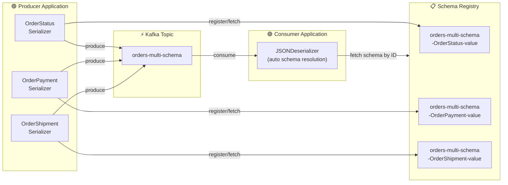
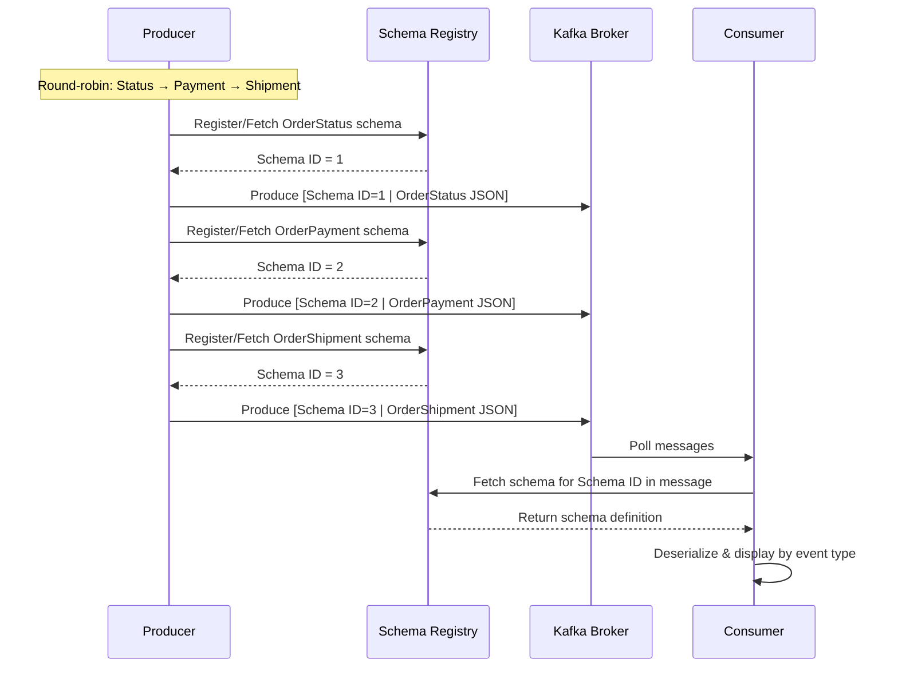

# Architecture — Multi-Schema Topic

## High-Level Architecture



## Subject Naming with TopicRecordNameStrategy

```
Subject Name = <topic>-<record_name>-value
```

| Event Type    | Subject Name                              |
| ------------- | ----------------------------------------- |
| OrderStatus   | `orders-multi-schema-OrderStatus-value`   |
| OrderPayment  | `orders-multi-schema-OrderPayment-value`  |
| OrderShipment | `orders-multi-schema-OrderShipment-value` |

## Message Flow



## Wire Format

Each message on the wire follows the Confluent Schema Registry wire format:

```
[Magic Byte (0x00)] [Schema ID (4 bytes)] [JSON Payload]
```

The consumer reads the Schema ID from bytes 1–4, fetches the corresponding
schema from Schema Registry, and uses it to deserialize/validate the JSON payload.
